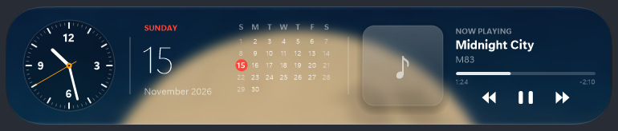
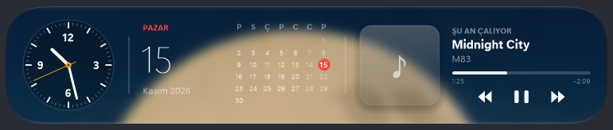
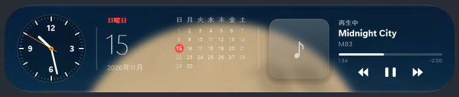

# Glass Widget Bar

A [Windhawk](https://windhawk.net) mod that puts a frosted-glass widget bar on your Windows desktop: an analog **clock**, a **calendar** and **music controls**, all drawn inside one blurred-wallpaper glass frame.

| Widget | What it does |
| --- | --- |
| **Clock** | Analog clock with an orange second hand |
| **Calendar** | Weekday, large day number and month grid; today is highlighted |
| **Music** | Whatever is playing right now (Spotify, browser, Media Player...) with cover art, progress and ⏮ ⏯ ⏭ buttons |

## Languages

Labels, day names and month names follow your **Windows display language** automatically, or you can pick one in the mod settings:

English · Türkçe · Deutsch · Français · Español · Italiano · Português (Brasil) · Nederlands · Polski · Русский · Українська · Čeština · Svenska · Dansk · Norsk bokmål · Suomi · Ελληνικά · Magyar · Română · Български · Bahasa Indonesia · Tiếng Việt · ไทย · हिन्दी · 日本語 · 한국어 · 简体中文 · 繁體中文

That is 28 languages. Other display languages fall back to English. The first day of the week follows your Windows regional format. Right-to-left languages are not supported yet. The translations are machine-assisted; corrections are very welcome (see [Contributing](#contributing)).

| Türkçe | Deutsch | 日本語 |
| --- | --- | --- |
|  |  |  |

## Install

1. Install [Windhawk](https://windhawk.net).
2. Open Windhawk, go to **Explore** and search for **Glass Widget Bar**, then **Install**.
   *(Until the mod is listed in the Windhawk catalog, use the manual way below.)*

**Manual install:** in Windhawk click **Create a new mod**, replace everything in the editor with the contents of [`glass-widget-bar.wh.cpp`](glass-widget-bar.wh.cpp), press **Compile Mod**, then enable it.

## Usage and settings

- The bar sits on the **desktop layer**: windows cover it. Press **Ctrl+Alt+W** to bring it to the front, press again to send it back. Or set the layer to "Always on top" in the settings.
- Settings: language, position (top or bottom center), layer, distance from the screen edge, frame opacity and blur.
- Works on the primary monitor only, and expects a picture wallpaper. If your wallpaper is very bright, raise the frame opacity.
- The music widget reads the Windows media session, so every app that publishes one is shown.
- Developed on Windows 11 (64-bit).

## Contributing

Issues and pull requests are welcome. To add or fix a language, edit the `kLangs` table near the top of `glass-widget-bar.wh.cpp` (four short strings per language) and add the language to the `language` setting list.

## Credits and license

The glass frame (rounded "squircle" corners, edge glow and edge lines) is ported from **MacOS Style Dock** by [Zach Vaughn](https://github.com/zachvdev), licensed GPL-3.0. This mod is therefore released under the **GNU GPL v3.0**, see [LICENSE](LICENSE).
